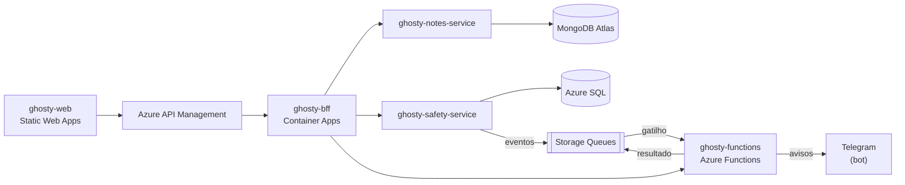

# Ghosty Web

App web de segurança pessoal discreto. Por fora, é um app de notas comum que funciona de verdade. Por dentro, tem uma área de segurança para avisar a rede de apoio da pessoa.

> **Status:** os 5 projetos de código estão implementados e testados: fachada de notas, desbloqueio pela busca, rede de apoio com convites (Telegram ou navegador), mensagem com prévia, pedido de ajuda, Teste seguro, check-in com prazo pela fila, `GET /aggregated-data` com as 3 fontes, PWA e saída rápida. O fluxo inteiro roda de ponta a ponta com os serviços reais (no CI também). A implantação na Azure está pronta em script ([`ghosty-docs/infra`](ghosty-docs/infra)).

Os avisos à rede de apoio saem pelo **Telegram** (bot) ou por uma **página web** aberta pelo contato, sem telefone, SMS nem WhatsApp. O ensaio (Teste seguro) mostra tudo o que aconteceria sem enviar nada. O Ghosty **não aciona** polícia nem serviços de emergência e não os substitui: 190 (Polícia Militar), 180 (Central de Atendimento à Mulher) e 192 (SAMU).

Projeto acadêmico da disciplina de Soluções Cloud.

## Arquitetura

Aplicação distribuída na Azure, com microfrontend, API Gateway, BFF, dois microserviços com bancos diferentes, Azure Functions e comunicação por eventos.



- **Front:** só conversa com o BFF, sempre pelo API Gateway.
- **BFF:** expõe `GET /aggregated-data`, que junta os dois microserviços e a Azure Function num único JSON.
- **Backends:** seguem Clean Architecture (`domain`, `application`, `infrastructure`, `api`) com Vertical Slice (um caso de uso por pasta), e têm testes de unidade e de arquitetura.

## Estrutura do repositório

| Pasta | Projeto | Tecnologias principais |
|---|---|---|
| [`ghosty-web/`](ghosty-web) | Microfrontend: shell + remotes `notes` e `safety` | React, Vite, Module Federation |
| [`ghosty-bff/`](ghosty-bff) | Backend for Frontend: agregação e proxy | NestJS |
| [`ghosty-notes-service/`](ghosty-notes-service) | Microserviço de notas | NestJS, MongoDB Atlas |
| [`ghosty-safety-service/`](ghosty-safety-service) | Microserviço de conta e rede de apoio | NestJS, Azure SQL |
| [`ghosty-functions/`](ghosty-functions) | Azure Functions: cálculo, enriquecimento e eventos | Azure Functions (Node.js) |
| [`ghosty-docs/`](ghosty-docs) | arc42, C4, AsyncAPI, contratos e infraestrutura | — |

Cada pasta tem o próprio README, com detalhes e instruções para rodar.

## Desenvolvimento

Pré-requisito: Node.js 24 LTS (versão em [`.nvmrc`](.nvmrc)). Cada projeto é independente: tem o próprio `package.json` e roda com `npm ci` dentro da pasta.

- **Tudo de uma vez.** `bash ghosty-docs/scripts/dev-local.sh --install` sobe filas, os 3 serviços, as Functions e o front num terminal só (veja o [`ghosty-docs`](ghosty-docs)).
- **Ponta a ponta.** `bash ghosty-docs/scripts/e2e-local.sh` roda o fluxo completo contra os serviços reais, sem Docker e sem Azure; o workflow `e2e.yml` faz o mesmo no GitHub Actions.
- **Nuvem.** [`ghosty-docs/infra/deploy.sh`](ghosty-docs/infra/deploy.sh) cria e configura tudo na Azure com o Azure CLI, por passos que podem rodar de novo, e termina com os testes de fumaça.
- **Contratos primeiro.** Os contratos OpenAPI e AsyncAPI ficam em [`ghosty-docs/contracts/`](ghosty-docs/contracts) e [`ghosty-docs/asyncapi/`](ghosty-docs/asyncapi). Cada frente desenvolve contra um mock gerado do contrato:

  ```bash
  cd ghosty-docs && npm ci && npm run mock:all   # BFF :4010 · notes :4011 · safety :4012 · functions :4013
  ```

- **Configuração compartilhada.** TypeScript, ESLint, Prettier, Vitest e as regras de arquitetura (ArchUnitTS) ficam em [`config/`](config). Cada projeto guarda uma cópia, atualizada com `node config/sync.mjs`, e o CI confere que nenhuma cópia divergiu.
- **CI.** Um workflow por projeto em [`.github/workflows/`](.github/workflows) (`ci-bff.yml`, `ci-notes.yml`, `ci-safety.yml`, `ci-functions.yml`, `ci-web.yml`, `ci-docs.yml`), cada um com filtro de caminho: `npm ci` → `lint` → `typecheck` → `test` → `build`, mais o build da imagem Docker nos 3 serviços. O `ci-repo.yml` valida os próprios workflows.
- **Imagens.** O [`docker.yml`](.github/workflows/docker.yml) publica `<usuario>/ghosty-bff`, `<usuario>/ghosty-notes-service` e `<usuario>/ghosty-safety-service` no Docker Hub quando uma tag `v*` é criada (`git tag v1 && git push origin v1`). Precisa dos secrets `DOCKERHUB_USERNAME` e `DOCKERHUB_TOKEN` no repositório.
- **Commits.** Conventional Commits em português (`feat:`, `fix:`, `test:`, `docs:`, `chore:`), uma branch por tarefa (`feat/<ID>-<descricao>`) e pull request com revisão.

## Alunos

- Amanda Fila de Lima
- Carlos Leonardo Garcia Pscheidt
- Rafael Della
- Gustavo Yuri
