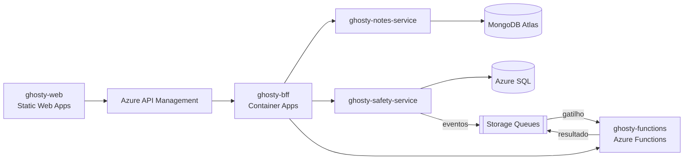

# Ghosty Web

App web de segurança pessoal discreto. Por fora, é um app de notas comum que funciona de verdade. Por dentro, tem uma área de segurança para avisar a rede de apoio da pessoa.

> **Status:** estrutura inicial. A implementação começa na Sprint 1.

Nesta fase, o envio de alertas é **simulado**: o sistema monta a mensagem e registra o que teria acontecido, sem enviar nada. O Ghosty não substitui os canais oficiais: 190 (Polícia Militar), 180 (Central de Atendimento à Mulher) e 192 (SAMU).

Projeto acadêmico da disciplina de Soluções Cloud.

## Arquitetura

Aplicação distribuída na Azure, com microfrontend, API Gateway, BFF, dois microserviços com bancos diferentes, Azure Functions e comunicação por eventos.

- **Front:** só conversa com o BFF, sempre pelo API Gateway.
- **BFF:** expõe `GET /aggregated-data`, que junta os dois microserviços e a Azure Function num único JSON.
- **Backends:** seguem Clean Architecture (`domain`, `application`, `infrastructure`, `api`) com Vertical Slice (um caso de uso por pasta), e têm testes de unidade e de arquitetura.

## Estrutura do repositório

| Pasta | Projeto | Tecnologias principais |
|---|---|---|
| [`ghosty-web/`](ghosty-web) | Microfrontend: shell + remotes `notes` e `safety` | React, Vite, Module Federation |
| [`ghosty-bff/`](ghosty-bff) | Backend for Frontend: agregação e proxy | NestJS |
| [`ghosty-notes-service/`](ghosty-notes-service) | Microserviço de notas | NestJS, MongoDB Atlas |
| [`ghosty-safety-service/`](ghosty-safety-service) | Microserviço de conta e rede de apoio | NestJS, Azure SQL |
| [`ghosty-functions/`](ghosty-functions) | Azure Functions: cálculo, enriquecimento e eventos | Azure Functions (Node.js) |
| [`ghosty-docs/`](ghosty-docs) | arc42, C4, AsyncAPI, contratos e infraestrutura | — |

Cada pasta tem o próprio README, com detalhes e instruções para rodar.

## Como contribuir

- Use o Node.js 24 LTS (versão em `.nvmrc`).
- A branch `main` é protegida e só recebe código por pull request, com 1 aprovação.
- Crie as branches no padrão `feat/<ID>-<descrição>`, com o ID da tarefa do backlog (ex.: `feat/SAF-05-contatos`).
- Escreva os commits no padrão Conventional Commits (`feat:`, `fix:`, `test:`, `docs:`, `chore:`).
- O modelo de pull request traz o checklist da definição de pronto.

## Alunos

- Amanda Fila de Lima
- Carlos Leonardo Garcia Pscheidt
- Rafael Della
- Gustavo Yuri
