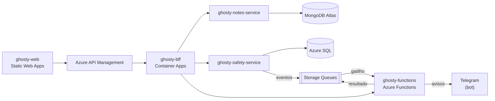

# ghosty-bff

Backend for Frontend (BFF) do Ghosty, em NestJS.

> **Status:** esqueleto completo (Swagger, Problem Details, `X-Correlation-Id`, segredo do gateway, `helmet`, CORS e limite de taxa), autenticação (JWT RS256 e JWKS), sessão segura e o repasse de notas, conta, rede de apoio, convite e mensagem. `/aggregated-data`, check-ins, pedidos de ajuda, convites públicos e a prévia da mensagem chegam na próxima etapa.

## Sobre o Ghosty

O **Ghosty** é um app web de segurança pessoal discreto. Por fora, é um app de notas comum que funciona de verdade. Por dentro, tem uma área de segurança para avisar a rede de apoio da pessoa.

Os avisos à rede de apoio saem pelo **Telegram** (bot) ou por uma **página web** aberta pelo contato, sem telefone, SMS nem WhatsApp. O ensaio (Teste seguro) não envia nada. O Ghosty não aciona nem substitui os canais oficiais (190, 180 e 192).

Projeto acadêmico da disciplina de Soluções Cloud.

## Arquitetura da solução



## Este projeto

O BFF é o único backend que o front chama, sempre pelo Azure API Management. Ele cuida de:

- autenticação e emissão do JWT (RS256), com JWKS publicado para o gateway;
- **`GET /aggregated-data`**, que consulta o `notes-service`, o `safety-service` e a Azure Function e devolve tudo num único JSON;
- proxy dos CRUDs para os microserviços;
- limite de requisições por usuário e por IP.

### Organização do código (Clean Architecture + Vertical Slice)

```text
src/
├── domain/          sessão segura (10 minutos sem uso, até 30 no total) e regra do código de desbloqueio
├── application/     casos de uso (auth, safety-session, account, notes, safety) e portas
├── infrastructure/  clientes HTTP dos serviços (timeout), JWT RS256 com jose, sessões em memória e variáveis (zod)
└── api/             controllers, DTOs, guards (gateway, JWT, sessão segura), limite de taxa e composição
    └── platform/    Problem Details, logs, /health e Swagger (cópia de config/nest, não editar)
```

As regras de dependência entre as camadas são verificadas por testes de arquitetura.

## Contrato e mock

O contrato v0 deste projeto está em [`ghosty-docs/contracts/bff.openapi.yaml`](../ghosty-docs/contracts/bff.openapi.yaml), com exemplos em cada operação. O mock sobe com `cd ../ghosty-docs && npm ci && npm run mock:bff` (porta 4010). Veja o [guia dos contratos e dos mocks](../ghosty-docs/contracts/README.md).

Enquanto os serviços não existem, aponte `NOTES_SERVICE_URL`, `SAFETY_SERVICE_URL` e `FUNCTIONS_BASE_URL` para os mocks (`http://localhost:4011`, `4012` e `4013`): `cd ../ghosty-docs && npm run mock:all`.

A configuração de TypeScript, ESLint, Prettier, Vitest e das regras de arquitetura vem de [`config/`](../config) (as cópias nesta pasta não devem ser editadas à mão).

## Tecnologias

- Node.js 24 + TypeScript
- NestJS 12 + `@nestjs/swagger`
- `jose` (JWT RS256 e JWKS)
- Vitest (testes de unidade) + ArchUnitTS (testes de arquitetura)
- Docker, Azure Container Apps

## Como rodar localmente

Pré-requisito: Node.js 24 LTS. O BFF chama o `notes-service` (3001) e o `safety-service` (3002); suba os dois antes (veja os READMEs deles) ou aponte as URLs para os mocks do `ghosty-docs` (`npm run mock:notes` na 4011 e `npm run mock:safety` na 4012).

```bash
npm ci
cp .env.example .env    # já funciona na máquina local
npm run start:dev       # porta 3000 · Swagger em http://localhost:3000/docs
```

- Sem `JWT_PRIVATE_KEY_PEM_B64`, o BFF gera uma chave temporária a cada subida (as sessões caem no restart). Em produção a chave é obrigatória (Key Vault).
- Sem `GATEWAY_SECRET`, a verificação do API Management fica desligada (na máquina local o front chama o BFF direto). Em produção é obrigatório.
- Fluxo rápido: `POST /auth/register` → use o `accessToken` em `Authorization: Bearer` → `PUT /account/lock-code` → `POST /safety/session` com o código → use o `safetyToken` em `X-Safety-Token` nas rotas `/safety/...`.

| Variável | Padrão local | Para quê |
|---|---|---|
| `PORT` · `PUBLIC_BASE_URL` | `3000` · `http://localhost:3000` | Porta e URL pública (é o `iss` do JWT) |
| `CORS_ORIGINS` | `http://localhost:5173` | Origens do front, separadas por vírgula |
| `GATEWAY_SECRET` · `TRUST_PROXY_HOPS` | vazio · `0` | Entrada só pelo APIM · proxies confiáveis (na Azure, 2) |
| `JWT_PRIVATE_KEY_PEM_B64` · `JWT_KEY_ID` · `JWT_AUDIENCE` | vazia · `dev` · `notes-web` | Chave RS256 (PKCS#8 em Base64), `kid` e `aud` |
| `ACCESS_TOKEN_TTL` · `SAFETY_TOKEN_TTL` · `SAFETY_SESSION_MAX` | `15m` · `10m` · `30m` | JWT de acesso, sessão segura sem uso e limite absoluto |
| `NOTES_SERVICE_URL` · `SAFETY_SERVICE_URL` · `INTERNAL_API_KEY` | `http://localhost:3001` · `http://localhost:3002` · `dev-internal-key` | Serviços internos e a chave do `X-Internal-Key` |
| `FUNCTIONS_BASE_URL` · `FUNCTIONS_KEY` | `http://localhost:7071` · vazia | Azure Function (prontidão e prévia) |
| `SAFETY_REMOTE_URL` | `http://localhost:5175/remoteEntry.js` | Remote `safety`, devolvido no desbloqueio |
| `UPSTREAM_TIMEOUT_MS` | `3000` | Timeout de cada chamada interna |
| `RATE_LIMIT_LOGIN_PER_MINUTE` · `RATE_LIMIT_USER_PER_MINUTE` | `5` · `60` | Login/cadastro por IP · requisições por usuário |

## Testes

```bash
npm test             # unidade, arquitetura e integração (com notes-service e safety-service falsos)
npm run test:cov     # cobertura de domain + application (mínimo de 80%)
npm run lint
npm run typecheck
npm run openapi:export   # grava o OpenAPI gerado pelo código em dist/openapi.json
```

Os testes de integração sobem o BFF de verdade contra serviços falsos (`node:http`) e cobrem: JWT RS256 conferido pelo JWKS, mesma resposta para senha errada e e-mail inexistente, 3 notas de exemplo no cadastro, rotação do refresh token, 401 sem JWT, repasse com `X-User-Id` e `X-Correlation-Id` (e sem `ownerId`), 403 sempre igual no código errado, 403 sem `X-Safety-Token` e depois da saída rápida, 403 sem `X-Gateway-Secret`, 429 com `Retry-After`, 503 com serviço fora do ar, CORS e exclusão da conta em cascata.

## Docker

O `Dockerfile` (multi-stage, usuário sem root) e o `.dockerignore` já estão nesta pasta. Sem Docker na máquina, as imagens são publicadas pelo GitHub Actions ([`docker.yml`](../.github/workflows/docker.yml)) ao criar uma tag `v*`. Com Docker:

```bash
docker build -t <usuario>/ghosty-bff:v1 .
docker push <usuario>/ghosty-bff:v1
```

## Na nuvem (Azure)

> Os links serão adicionados depois do deploy.

## Projetos do repositório

| Pasta | Papel |
|---|---|
| [`ghosty-web`](../ghosty-web) | Microfrontend (shell + remotes `notes` e `safety`) |
| [`ghosty-bff`](../ghosty-bff) | Backend for Frontend: agregação e proxy |
| [`ghosty-notes-service`](../ghosty-notes-service) | Microserviço de notas (MongoDB Atlas) |
| [`ghosty-safety-service`](../ghosty-safety-service) | Microserviço de conta e rede de apoio (Azure SQL) |
| [`ghosty-functions`](../ghosty-functions) | Azure Functions: cálculo, enriquecimento e eventos |
| [`ghosty-docs`](../ghosty-docs) | Documentação: arc42, C4, AsyncAPI, contratos e infraestrutura |

## Alunos

- Amanda Fila de Lima
- Carlos Leonardo Garcia Pscheidt
- Rafael Della
- Gustavo Yuri
