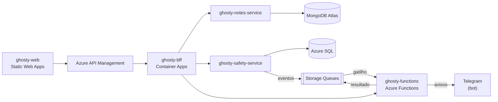

# ghosty-bff

Backend for Frontend (BFF) do Ghosty, em NestJS.

> **Status:** contrato v0 e configuração compartilhada prontos. O código começa na Sprint 1.

## Sobre o Ghosty

O **Ghosty** é um app web de segurança pessoal discreto. Por fora, é um app de notas comum que funciona de verdade. Por dentro, tem uma área de segurança para avisar a rede de apoio da pessoa.

Os avisos à rede de apoio saem pelo **Telegram** (bot) ou por uma **página web** aberta pelo contato, sem telefone, SMS nem WhatsApp. O ensaio (Teste seguro) não envia nada. O Ghosty não aciona nem substitui os canais oficiais (190, 180 e 192).

Projeto acadêmico da disciplina de Soluções Cloud.

## Arquitetura da solução



## Este projeto

O BFF é o único backend que o front chama, sempre pelo Azure API Management. Ele cuida de:

- autenticação e emissão do JWT (RS256), com JWKS publicado para o gateway;
- **`GET /aggregated-data`**, que consulta o `notes-service`, o `safety-service` e a Azure Function e devolve tudo num único JSON;
- proxy dos CRUDs para os microserviços;
- limite de requisições por usuário e por IP.

### Organização do código (Clean Architecture + Vertical Slice)

```text
src/
├── domain/          modelos e regras, sem dependências externas
├── application/     casos de uso organizados por feature (features/<feature>/<caso-de-uso>/)
├── infrastructure/  clientes HTTP, JWT e configuração
└── api/             controllers, DTOs, guards e Swagger (composição)
```

As regras de dependência entre as camadas são verificadas por testes de arquitetura.

## Contrato e mock

O contrato v0 deste projeto está em [`ghosty-docs/contracts/bff.openapi.yaml`](../ghosty-docs/contracts/bff.openapi.yaml), com exemplos em cada operação. O mock sobe com `cd ../ghosty-docs && npm ci && npm run mock:bff` (porta 4010). Veja o [guia dos contratos e dos mocks](../ghosty-docs/contracts/README.md).

Enquanto os serviços não existem, aponte `NOTES_SERVICE_URL`, `SAFETY_SERVICE_URL` e `FUNCTIONS_BASE_URL` para os mocks (`http://localhost:4011`, `4012` e `4013`): `cd ../ghosty-docs && npm run mock:all`.

A configuração de TypeScript, ESLint, Prettier, Vitest e das regras de arquitetura vem de [`config/`](../config) (as cópias nesta pasta não devem ser editadas à mão).

## Tecnologias

- Node.js 24 + TypeScript
- NestJS 12 + `@nestjs/swagger`
- `jose` (JWT RS256 e JWKS)
- Vitest (testes de unidade) + ArchUnitTS (testes de arquitetura)
- Docker, Azure Container Apps

## Como rodar localmente

> Em construção.

Pré-requisito: Node.js 24 LTS (versão em `.nvmrc`).

Comandos previstos:

```bash
npm ci
cp .env.example .env
npm run start:dev   # porta 3000 · Swagger em http://localhost:3000/docs
```

## Testes

> Em construção. Comandos previstos: `npm test` (unidade e arquitetura).

## Docker

O `Dockerfile` (multi-stage, usuário sem root) e o `.dockerignore` já estão nesta pasta. Sem Docker na máquina, as imagens são publicadas pelo GitHub Actions ([`docker.yml`](../.github/workflows/docker.yml)) ao criar uma tag `v*`. Com Docker:

```bash
docker build -t <usuario>/ghosty-bff:v1 .
docker push <usuario>/ghosty-bff:v1
```

## Na nuvem (Azure)

> Os links serão adicionados depois do deploy.

## Projetos do repositório

| Pasta | Papel |
|---|---|
| [`ghosty-web`](../ghosty-web) | Microfrontend (shell + remotes `notes` e `safety`) |
| [`ghosty-bff`](../ghosty-bff) | Backend for Frontend: agregação e proxy |
| [`ghosty-notes-service`](../ghosty-notes-service) | Microserviço de notas (MongoDB Atlas) |
| [`ghosty-safety-service`](../ghosty-safety-service) | Microserviço de conta e rede de apoio (Azure SQL) |
| [`ghosty-functions`](../ghosty-functions) | Azure Functions: cálculo, enriquecimento e eventos |
| [`ghosty-docs`](../ghosty-docs) | Documentação: arc42, C4, AsyncAPI, contratos e infraestrutura |

## Alunos

- Amanda Fila de Lima
- Carlos Leonardo Garcia Pscheidt
- Rafael Della
- Gustavo Yuri
