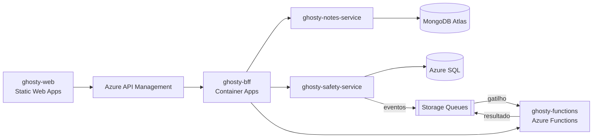

# ghosty-bff

Backend for Frontend (BFF) do Ghosty, em NestJS.

> **Status:** estrutura inicial. A implementação começa na Sprint 1.

## Sobre o Ghosty

O **Ghosty** é um app web de segurança pessoal discreto. Por fora, é um app de notas comum que funciona de verdade. Por dentro, tem uma área de segurança para avisar a rede de apoio da pessoa.

Nesta fase, o envio de alertas é **simulado**: o sistema monta a mensagem e registra o que teria acontecido, sem enviar nada. O Ghosty não substitui os canais oficiais (190, 180 e 192).

Projeto acadêmico da disciplina de Soluções Cloud.

## Arquitetura da solução



## Este projeto

O BFF é o único backend que o front chama, sempre pelo Azure API Management. Ele cuida de:

- autenticação e emissão do JWT (RS256), com JWKS publicado para o gateway;
- **`GET /aggregated-data`**, que consulta o `notes-service`, o `safety-service` e a Azure Function e devolve tudo num único JSON;
- proxy dos CRUDs para os microserviços;
- limite de requisições por usuário e por IP.

### Organização do código (Clean Architecture + Vertical Slice)

```text
src/
├── domain/          modelos e regras, sem dependências externas
├── application/     casos de uso organizados por feature (features/<feature>/<caso-de-uso>/)
├── infrastructure/  clientes HTTP, JWT e configuração
└── api/             controllers, DTOs, guards e Swagger (composição)
```

As regras de dependência entre as camadas são verificadas por testes de arquitetura.

## Tecnologias

- Node.js 24 + TypeScript
- NestJS 12 + `@nestjs/swagger`
- `jose` (JWT RS256 e JWKS)
- Vitest (testes de unidade) + ArchUnitTS (testes de arquitetura)
- Docker, Azure Container Apps

## Como rodar localmente

> Em construção.

Pré-requisito: Node.js 24 LTS (versão em `.nvmrc`).

Comandos previstos:

```bash
npm ci
cp .env.example .env
npm run start:dev   # porta 3000 · Swagger em http://localhost:3000/docs
```

## Testes

> Em construção. Comandos previstos: `npm test` (unidade e arquitetura).

## Docker

```bash
docker build -t <usuario>/ghosty-bff:v1 .
docker push <usuario>/ghosty-bff:v1
```

## Na nuvem (Azure)

> Os links serão adicionados depois do deploy.

## Projetos do repositório

| Pasta | Papel |
|---|---|
| [`ghosty-web`](../ghosty-web) | Microfrontend (shell + remotes `notes` e `safety`) |
| [`ghosty-bff`](../ghosty-bff) | Backend for Frontend: agregação e proxy |
| [`ghosty-notes-service`](../ghosty-notes-service) | Microserviço de notas (MongoDB Atlas) |
| [`ghosty-safety-service`](../ghosty-safety-service) | Microserviço de conta e rede de apoio (Azure SQL) |
| [`ghosty-functions`](../ghosty-functions) | Azure Functions: cálculo, enriquecimento e eventos |
| [`ghosty-docs`](../ghosty-docs) | Documentação: arc42, C4, AsyncAPI, contratos e infraestrutura |

## Alunos

- Amanda Fila de Lima
- Carlos Leonardo Garcia Pscheidt
- Rafael Della
- Gustavo Yuri
