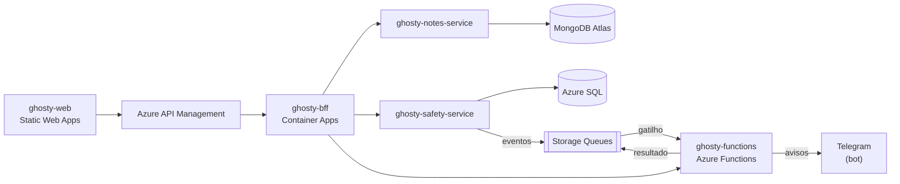

# ghosty-docs

Documentação e infraestrutura do Ghosty.

> **Status:** contratos v0 prontos (4 OpenAPI e o AsyncAPI), com mocks e validação no CI. O restante da documentação é produzido ao longo das sprints.

## Sobre o Ghosty

O **Ghosty** é um app web de segurança pessoal discreto. Por fora, é um app de notas comum que funciona de verdade. Por dentro, tem uma área de segurança para avisar a rede de apoio da pessoa.

Os avisos à rede de apoio saem pelo **Telegram** (bot) ou por uma **página web** aberta pelo contato, sem telefone, SMS nem WhatsApp. O ensaio (Teste seguro) não envia nada. O Ghosty não aciona nem substitui os canais oficiais (190, 180 e 192).

Projeto acadêmico da disciplina de Soluções Cloud.

## Arquitetura da solução



## Este projeto

```text
contracts/   contratos OpenAPI do BFF, do notes-service, do safety-service e das functions   (pronto, v0)
asyncapi/    especificação dos eventos (AsyncAPI 3.0), JSON Schemas e mensagens de exemplo     (pronto, v0)
scripts/     teste de fumaça dos mocks; depois, os scripts de desenvolvimento local e de nuvem
test/        validação dos contratos (convenções, AsyncAPI e exemplos com ajv)
arc42/       documentação de arquitetura (exportada em PDF para a entrega)                       (a fazer)
c4/          diagramas C4: contexto, containers e componentes                                    (a fazer)
apim/        políticas do Azure API Management                                                   (a fazer)
compose/     docker-compose para rodar tudo com containers                                       (a fazer)
```

- [Contratos de API, convenções e guia dos mocks](contracts/README.md)
- [Eventos (AsyncAPI)](asyncapi/README.md)

## Como rodar localmente

Pré-requisito: Node.js 24 LTS (versão em `.nvmrc`). Não precisa de `.env`.

```bash
cd ghosty-docs
npm ci
npm run mock:all     # mocks: BFF :4010 · notes-service :4011 · safety-service :4012 · functions :4013
```

| Comando | O que faz |
|---|---|
| `npm run mock:all` | Sobe os 4 mocks do Prism a partir dos contratos (ou `mock:bff`, `mock:notes`, `mock:safety`, `mock:functions`) |
| `npm run lint` | Lint dos 4 contratos OpenAPI (Redocly) e formatação (Prettier) |
| `npm test` | Convenções dos contratos, validade do AsyncAPI e exemplos de eventos contra os schemas (`ajv`) |
| `npm run test:mocks` | Sobe os 4 mocks, faz chamadas reais e derruba tudo |
| `npm run format` | Formata YAML, JSON e scripts com o Prettier |

## CI

O workflow `ci-docs.yml` roda `lint`, `test` e `test:mocks` a cada pull request que mexe nesta pasta. Mudanças nos contratos também disparam o CI de quem consome cada um (por exemplo, o `bff.openapi.yaml` dispara o `ci-web.yml`).

## Links da entrega

> Preenchidos depois do deploy.

| Item | Link |
|---|---|
| Frontend | — |
| API Gateway | — |
| Swagger do BFF | — |
| Swagger do notes-service | — |
| Swagger do safety-service | — |
| Documentação dos eventos (AsyncAPI) | — |
| Imagens no Docker Hub | — |
| Vídeo no YouTube | — |

## Projetos do repositório

| Pasta | Papel |
|---|---|
| [`ghosty-web`](../ghosty-web) | Microfrontend (shell + remotes `notes` e `safety`) |
| [`ghosty-bff`](../ghosty-bff) | Backend for Frontend: agregação e proxy |
| [`ghosty-notes-service`](../ghosty-notes-service) | Microserviço de notas (MongoDB Atlas) |
| [`ghosty-safety-service`](../ghosty-safety-service) | Microserviço de conta e rede de apoio (Azure SQL) |
| [`ghosty-functions`](../ghosty-functions) | Azure Functions: cálculo, enriquecimento e eventos |
| [`ghosty-docs`](../ghosty-docs) | Documentação: arc42, C4, AsyncAPI, contratos e infraestrutura |

## Alunos

- Amanda Fila de Lima
- Carlos Leonardo Garcia Pscheidt
- Rafael Della
- Gustavo Yuri
