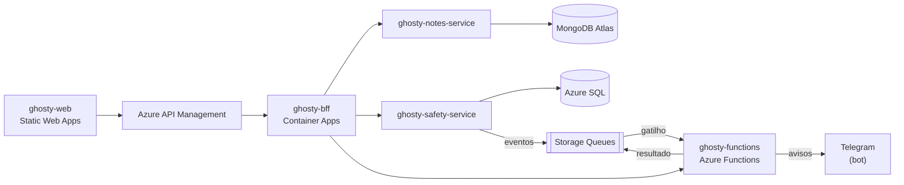

# ghosty-docs

Documentação e infraestrutura do Ghosty.

> **Status:** contratos (4 OpenAPI e o AsyncAPI) com mocks e validação no CI, C4, arc42 com o Canvas e os prints da nuvem em anexo, políticas do API Management, implantação na Azure por script, desenvolvimento local com um comando e o teste de ponta a ponta.

## Sobre o Ghosty

O **Ghosty** é um app web de segurança pessoal discreto. Por fora, é um app de notas comum que funciona de verdade. Por dentro, tem uma área de segurança para avisar a rede de apoio da pessoa.

Os avisos à rede de apoio saem pelo **Telegram** (bot) ou por uma **página web** aberta pelo contato, sem telefone, SMS nem WhatsApp. O ensaio (Teste seguro) não envia nada. O Ghosty não aciona nem substitui os canais oficiais (190, 180 e 192).

Projeto acadêmico da disciplina de Soluções Cloud.

## Arquitetura da solução



## Este projeto

```text
contracts/   contratos OpenAPI do BFF, do notes-service, do safety-service e das functions
asyncapi/    especificação dos eventos (AsyncAPI 3.0), JSON Schemas e mensagens de exemplo
c4/          diagramas C4: contexto, containers e componentes (Mermaid)
arc42/       documentação de arquitetura (exportada em PDF para a entrega) e os prints da nuvem (arc42/prints)
canvas/      Lean Canvas do produto (HTML, PNG e PDF)
apim/        políticas do Azure API Management (XML) e os named values
infra/       implantação na Azure com o Azure CLI (deploy.sh), por passos
compose/     docker compose para rodar tudo com containers (quando houver Docker)
scripts/     desenvolvimento local, teste de ponta a ponta, página de documentação, prints, Canvas e fumaça dos mocks
test/        validação dos contratos (convenções, AsyncAPI e exemplos com ajv)
```

- [Contratos de API, convenções e guia dos mocks](contracts/README.md)
- [Eventos (AsyncAPI)](asyncapi/README.md)
- [C4 Model](c4/README.md) · [arc42](arc42/arc42.md) · [Canvas](canvas/canvas.png)
- [Políticas do API Management](apim/README.md) · [Implantação na Azure](infra/README.md)

## Como rodar localmente

Pré-requisito: Node.js 24 LTS (versão em `.nvmrc`). Não precisa de `.env`.

```bash
cd ghosty-docs
npm ci
npm run mock:all     # mocks: BFF :4010 · notes-service :4011 · safety-service :4012 · functions :4013
```

| Comando | O que faz |
|---|---|
| `npm run mock:all` | Sobe os 4 mocks do Prism a partir dos contratos (ou `mock:bff`, `mock:notes`, `mock:safety`, `mock:functions`) |
| `npm run lint` | Lint dos 4 contratos OpenAPI (Redocly) e formatação (Prettier) |
| `npm test` | Convenções dos contratos, validade do AsyncAPI, exemplos de eventos contra os schemas (`ajv`) e o arc42 (seções, links da entrega e o PDF montado com o C4) |
| `npm run test:mocks` | Sobe os 4 mocks, faz chamadas reais e derruba tudo |
| `npm run e2e:local` | Teste de ponta a ponta com os serviços reais (precisa do build dos 4 backends) |
| `npm run asyncapi:html` | HTML navegável dos eventos em `site/events` (gerador oficial, baixado pelo `npx`) |
| `npm run site:build` | Página de documentação em `site/` (links, Swagger UI de cada API e os eventos) |
| `npm run arc42:pdf` | PDF da entrega em `dist/arc42/arc42.pdf`: o arc42 com o C4, o Canvas e os prints em anexo e os diagramas desenhados (usa o Chrome em modo headless; sem internet, `MERMAID_JS=<mermaid.min.js local>`) |
| `npm run prints` | Prints da entrega em `arc42/prints/`, tirados das URLs da nuvem (tabela "Links da entrega" do arc42): Swaggers, AsyncAPI, API Gateway, front na conta de demonstração, Docker Hub e GitHub Actions. Precisa de `DEMO_PASSWORD` e `DEMO_LOCK_CODE` (ou `AZURE_ENV_FILE=infra/azure.env`); `PRINTS_ONLY=front,swagger` tira só alguns |
| `npm run canvas` | Desenha o `canvas/canvas.html` em `canvas/canvas.png` e `canvas/canvas.pdf` (A4 deitado) |
| `npm run format` | Formata YAML, JSON e scripts com o Prettier |

### Tudo de uma vez na máquina local

```bash
bash scripts/dev-local.sh --install   # na primeira vez (npm ci nos 6 projetos); depois, sem --install
```

Sobe filas (Azurite), safety-service (SQLite), notes-service (MongoDB em memória), Functions, BFF e o front (5173, 5174 e 5175) num terminal só, e cria os `.env` a partir dos exemplos na primeira vez. As Functions sobem com o `func start` se o Core Tools estiver instalado; sem ele, com o host local de testes. Funciona no Linux, no macOS e no Git Bash do Windows. Abra http://localhost:5173, crie uma conta, defina o código em Configurações e digite-o na busca para abrir a área segura.

### Teste de ponta a ponta

```bash
for d in ghosty-safety-service ghosty-notes-service ghosty-functions ghosty-bff; do (cd ../$d && npm ci && npm run build); done
npm run e2e:local
```

O fluxo ([`scripts/e2e-flow.mjs`](scripts/e2e-flow.mjs)) passa por cadastro, notas, desbloqueio, rede de apoio (um contato pelo `/start` do bot e outro pelo navegador), mensagem e prévia, `/aggregated-data`, Teste seguro (nada enviado), pedido de ajuda real (aviso na página do contato), check-in estendido e confirmado, check-in de ensaio que vence pela fila com atraso, saída rápida e exclusão da conta. O workflow `e2e.yml` roda o mesmo teste no GitHub Actions. Na nuvem, o passo `smoke` do `infra/deploy.sh` roda o fluxo pelo API Management.

## CI

O workflow `ci-docs.yml` roda `lint`, `test` e `test:mocks` a cada pull request que mexe nesta pasta. Mudanças nos contratos também disparam o CI de quem consome cada um (por exemplo, o `bff.openapi.yaml` dispara o `ci-web.yml`).

## Links da entrega

A [página de documentação](https://proud-field-09986c10f.3.azurestaticapps.net) reúne todos (`bash infra/deploy.sh status` imprime de novo).

| Item | Link |
|---|---|
| Frontend | https://delightful-flower-05caf9c0f.6.azurestaticapps.net |
| API Gateway | https://apim-notas-oigv.azure-api.net |
| Swagger do API Gateway | https://proud-field-09986c10f.3.azurestaticapps.net/swagger.html?spec=apim-web-bff |
| Swagger do BFF | https://app-web-api.graybeach-32f9183a.brazilsouth.azurecontainerapps.io/docs |
| Swagger do notes-service | https://app-notes.graybeach-32f9183a.brazilsouth.azurecontainerapps.io/docs |
| Swagger do safety-service | https://app-core.graybeach-32f9183a.brazilsouth.azurecontainerapps.io/docs |
| Swagger da Azure Function | https://func-notas-oigv.azurewebsites.net/api/docs |
| Documentação dos eventos (AsyncAPI) | https://proud-field-09986c10f.3.azurestaticapps.net/events/ |
| Imagens no Docker Hub | https://hub.docker.com/u/oldspiffy |
| Canvas | [canvas/canvas.png](canvas/canvas.png) · [canvas/canvas.pdf](canvas/canvas.pdf) |
| Prints da nuvem | [anexo do arc42](arc42/arc42.md#anexo-prints-do-app-na-azure) |
| Vídeo no YouTube | — |

## Projetos do repositório

| Pasta | Papel |
|---|---|
| [`ghosty-web`](../ghosty-web) | Microfrontend (shell + remotes `notes` e `safety`) |
| [`ghosty-bff`](../ghosty-bff) | Backend for Frontend: agregação e proxy |
| [`ghosty-notes-service`](../ghosty-notes-service) | Microserviço de notas (MongoDB Atlas) |
| [`ghosty-safety-service`](../ghosty-safety-service) | Microserviço de conta e rede de apoio (Azure SQL) |
| [`ghosty-functions`](../ghosty-functions) | Azure Functions: cálculo, enriquecimento e eventos |
| [`ghosty-docs`](../ghosty-docs) | Documentação: arc42, C4, AsyncAPI, contratos e infraestrutura |

## Alunos

- Amanda Fila de Lima
- Carlos Leonardo Garcia Pscheidt
- Rafael Della
- Gustavo Yuri
