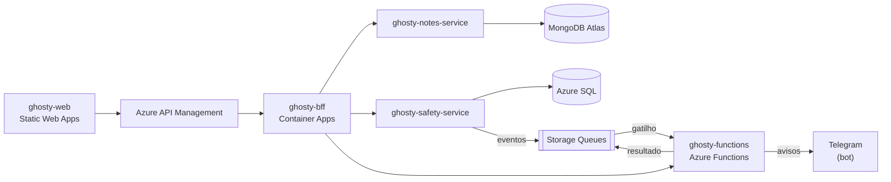

# ghosty-docs

Documentação e infraestrutura do Ghosty.

> **Status:** estrutura inicial. O conteúdo é produzido ao longo das sprints.

## Sobre o Ghosty

O **Ghosty** é um app web de segurança pessoal discreto. Por fora, é um app de notas comum que funciona de verdade. Por dentro, tem uma área de segurança para avisar a rede de apoio da pessoa.

Os avisos à rede de apoio saem pelo **Telegram** (bot) ou por uma **página web** aberta pelo contato, sem telefone, SMS nem WhatsApp. O ensaio (Teste seguro) não envia nada. O Ghosty não aciona nem substitui os canais oficiais (190, 180 e 192).

Projeto acadêmico da disciplina de Soluções Cloud.

## Arquitetura da solução



## Este projeto

Estrutura prevista:

```text
arc42/       documentação de arquitetura (exportada em PDF para a entrega)
c4/          diagramas C4: contexto, containers e componentes
contracts/   contratos OpenAPI do BFF, do notes-service, do safety-service e das functions
asyncapi/    especificação dos eventos (AsyncAPI 3.0) e mensagens de exemplo
apim/        políticas do Azure API Management
scripts/     scripts de desenvolvimento local e de nuvem
compose/     docker-compose para rodar tudo com containers
```

## Links da entrega

> Preenchidos depois do deploy.

| Item | Link |
|---|---|
| Frontend | — |
| API Gateway | — |
| Swagger do BFF | — |
| Swagger do notes-service | — |
| Swagger do safety-service | — |
| Documentação dos eventos (AsyncAPI) | — |
| Imagens no Docker Hub | — |
| Vídeo no YouTube | — |

## Projetos do repositório

| Pasta | Papel |
|---|---|
| [`ghosty-web`](../ghosty-web) | Microfrontend (shell + remotes `notes` e `safety`) |
| [`ghosty-bff`](../ghosty-bff) | Backend for Frontend: agregação e proxy |
| [`ghosty-notes-service`](../ghosty-notes-service) | Microserviço de notas (MongoDB Atlas) |
| [`ghosty-safety-service`](../ghosty-safety-service) | Microserviço de conta e rede de apoio (Azure SQL) |
| [`ghosty-functions`](../ghosty-functions) | Azure Functions: cálculo, enriquecimento e eventos |
| [`ghosty-docs`](../ghosty-docs) | Documentação: arc42, C4, AsyncAPI, contratos e infraestrutura |

## Alunos

- Amanda Fila de Lima
- Carlos Leonardo Garcia Pscheidt
- Rafael Della
- Gustavo Yuri
