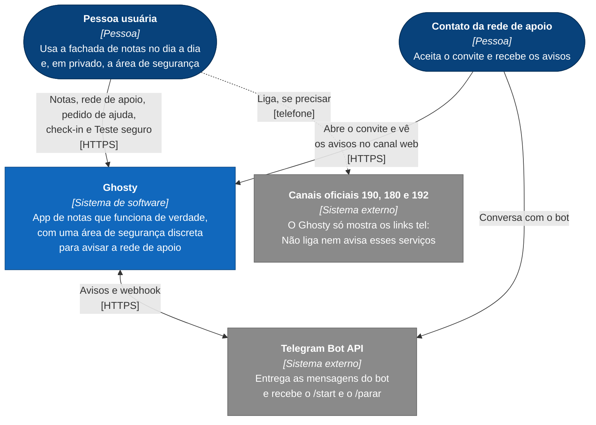
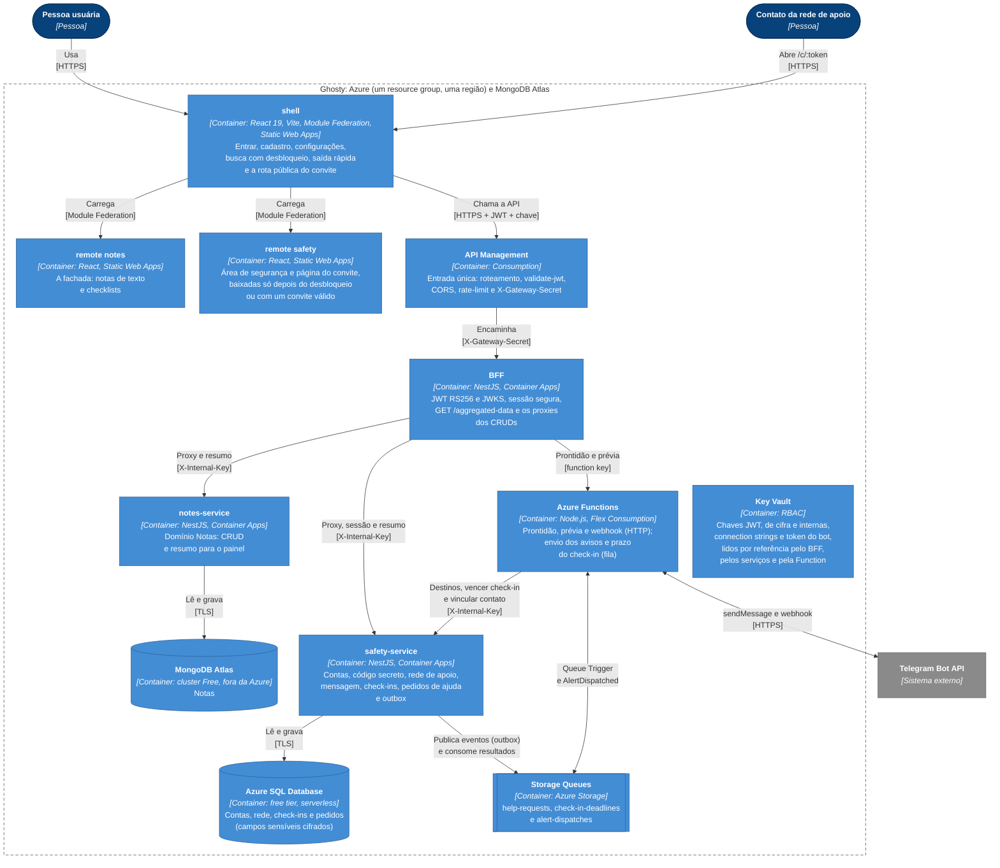
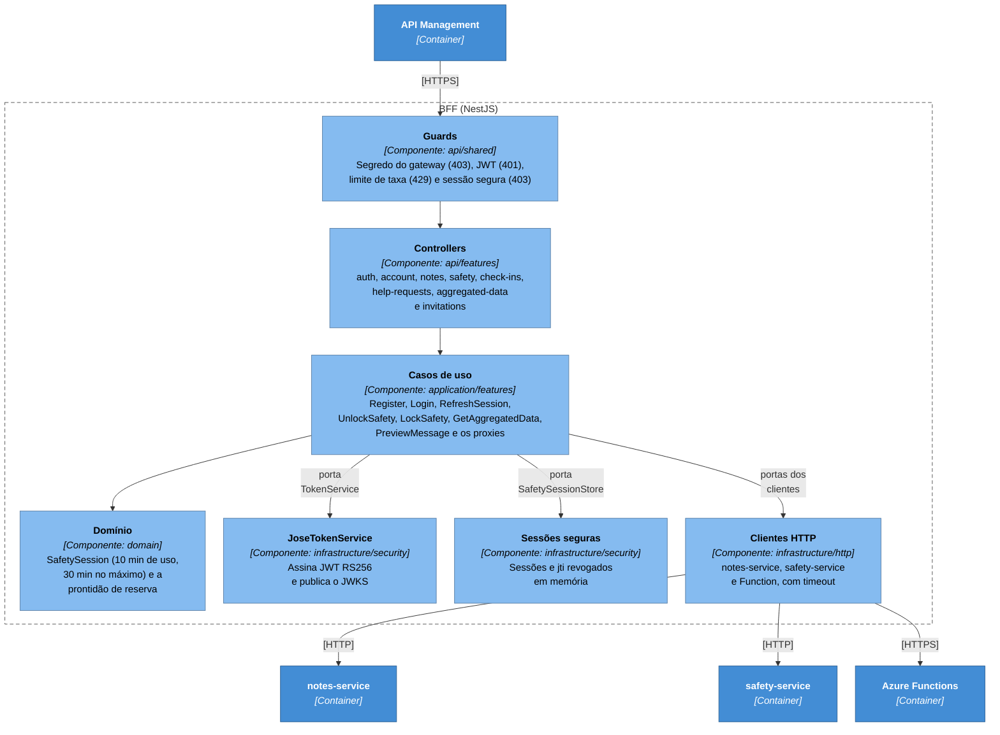
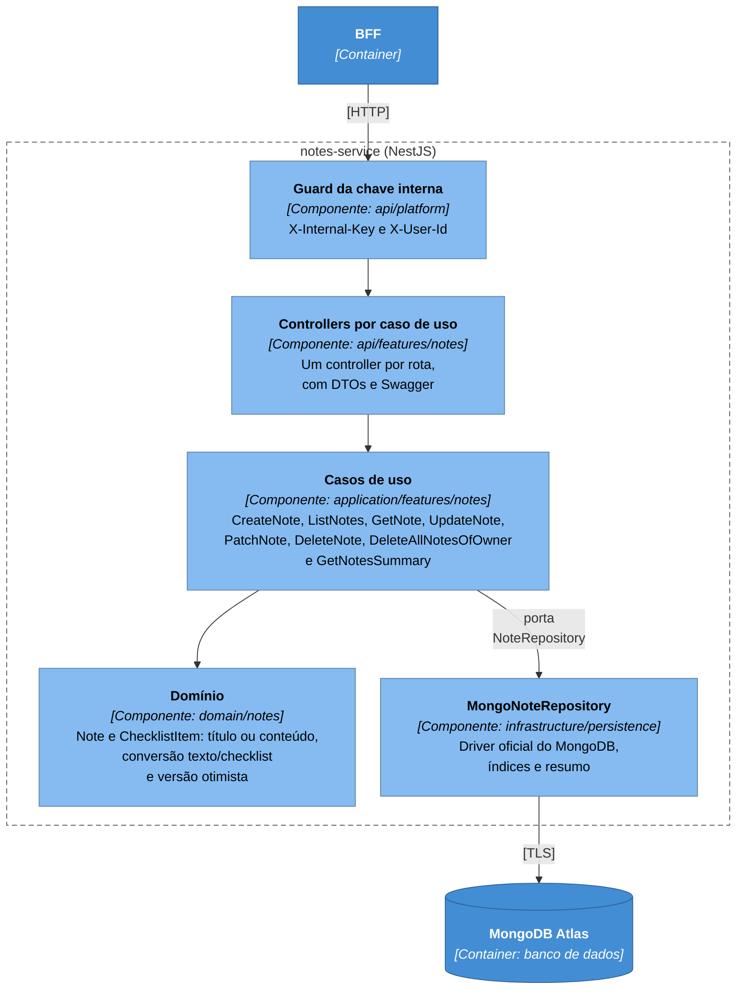
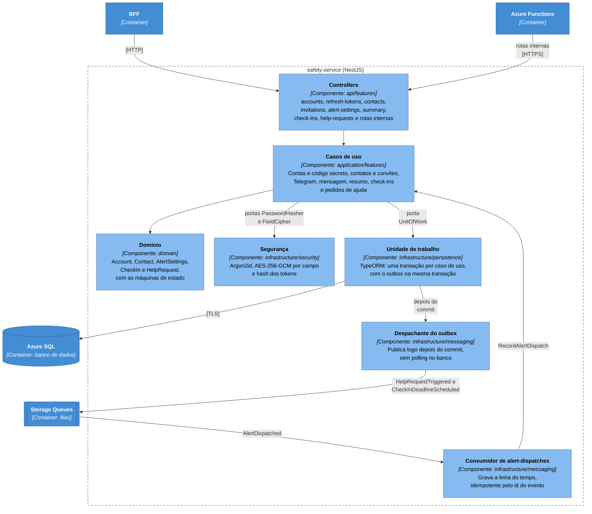
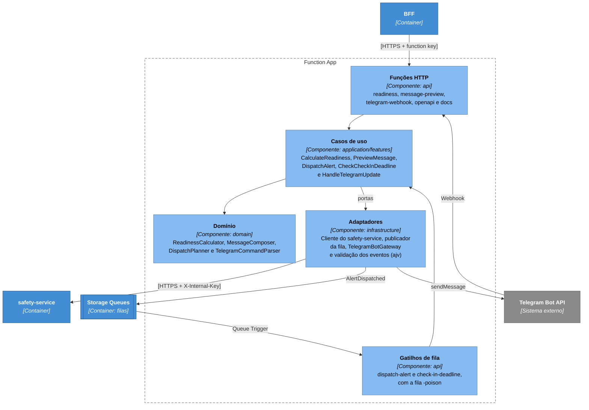

# C4 Model

Diagramas em Mermaid, na notação do C4 (o GitHub desenha direto). Para exportar em PNG, cole o bloco no [Mermaid Live Editor](https://mermaid.live).

**Legenda:** pessoas em azul-escuro, com cantos arredondados; o sistema em azul; containers em azul-médio; componentes em azul-claro; sistemas externos em cinza. Bancos de dados aparecem como cilindros, filas com borda dupla e os limites (sistema, container, assinatura) como retângulos tracejados. Cada caixa traz o nome, o tipo entre colchetes e o que faz; cada seta, o que passa por ela e, entre colchetes, o protocolo.

## 1. Contexto

## 2. Containers

## 3. Componentes

Todos os backends seguem Clean Architecture com Vertical Slice: `domain` (regras puras), `application/features/<feature>/<caso-de-uso>` (um handler por caso de uso, com portas), `infrastructure` (adaptadores) e a camada de entrada `api` (controllers nos serviços NestJS, funções HTTP e de fila na Function App). As dependências só apontam para dentro, e testes de arquitetura (ArchUnitTS) verificam isso.

### 3.1 BFF

### 3.2 notes-service

### 3.3 safety-service

### 3.4 Azure Functions

