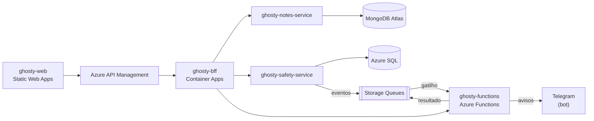

# ghosty-functions

Azure Functions do Ghosty: cálculo, enriquecimento de dados e processamento de eventos.

> **Status:** pronto e testado: domínio (prontidão, mensagem, limite de caracteres, plano de envio e comandos do bot), funções HTTP `readiness`, `message-preview`, `telegram-webhook` e `openapi`, os gatilhos de fila `dispatch-alert` e `check-in-deadline`, e os comandos `telegram:poll` e `telegram:webhook`.

## Sobre o Ghosty

O **Ghosty** é um app web de segurança pessoal discreto. Por fora, é um app de notas comum que funciona de verdade. Por dentro, tem uma área de segurança para avisar a rede de apoio da pessoa.

Os avisos à rede de apoio saem pelo **Telegram** (bot) ou por uma **página web** aberta pelo contato, sem telefone, SMS nem WhatsApp. O ensaio (Teste seguro) não envia nada. O Ghosty não aciona nem substitui os canais oficiais (190, 180 e 192).

Projeto acadêmico da disciplina de Soluções Cloud.

## Arquitetura da solução



## Este projeto

| Função | Gatilho | O que faz |
|---|---|---|
| `readiness` | HTTP | Calcula a prontidão da rede de apoio (pontuação e recomendações) |
| `message-preview` | HTTP | Enriquece a mensagem de alerta: link do mapa, horário local e contagem de caracteres (limite de 4.096 do Telegram) |
| `dispatch-alert` | Fila `help-requests` | Envia o aviso a cada contato confirmado, em ordem, pelo Telegram (ou registra para a página web do contato). No ensaio ou com `DELIVERY_MODE=simulated`, não envia nada |
| `telegram-webhook` | HTTP | Recebe o `/start` e o `/parar` do bot e vincula o contato à rede de apoio |
| `check-in-deadline` | Fila `check-in-deadlines` | Verifica no prazo se o check-in foi confirmado |

### Organização do código (Clean Architecture + Vertical Slice)

```text
src/
├── domain/          calculadoras e regras puras (prontidão, mensagem, limite de caracteres, plano de envio)
├── application/     casos de uso organizados por feature
├── infrastructure/  cliente HTTP do safety-service, publicação em filas e cliente do Telegram
├── api/             camada de entrada (API): registro dos gatilhos HTTP e de fila, cada função monta as próprias dependências
└── cli/             ferramenta de linha de comando do bot (polling local e webhook), fora da aplicação
```

## Contrato e mock

O contrato v0 deste projeto está em [`ghosty-docs/contracts/functions.openapi.yaml`](../ghosty-docs/contracts/functions.openapi.yaml), com exemplos em cada operação. O mock sobe com `cd ../ghosty-docs && npm ci && npm run mock:functions` (porta 4013). Veja o [guia dos contratos e dos mocks](../ghosty-docs/contracts/README.md).

As funções de fila seguem o [AsyncAPI](../ghosty-docs/asyncapi/asyncapi.yaml), e as mensagens de exemplo de `ghosty-docs/asyncapi/examples/` servem de fixtures nos testes.

A configuração de TypeScript, ESLint, Prettier, Vitest e das regras de arquitetura vem de [`config/`](../config) (as cópias nesta pasta não devem ser editadas à mão).

## Tecnologias

- Node.js 24 + TypeScript
- Azure Functions (modelo de programação v4), plano Flex Consumption
- Azure Storage Queues (Azurite na máquina local)
- Vitest

## Como rodar localmente

Pré-requisitos: Node.js 24 LTS, [Azure Functions Core Tools v4](https://learn.microsoft.com/azure/azure-functions/functions-run-local) (`npm i -g azure-functions-core-tools@4 --unsafe-perm true`) e o Azurite para as filas.

```bash
npm ci
cp local.settings.example.json local.settings.json   # nunca vai para o Git
npx azurite-queue --inMemoryPersistence --skipApiVersionCheck   # outro terminal (ou: azurite)
npm start               # compila e roda o func start na porta 7071
```

- Swagger UI em http://localhost:7071/api/docs e o contrato em http://localhost:7071/api/openapi.json.
- `DELIVERY_MODE=simulated` (padrão): nada sai pelo Telegram, os passos ficam `would_send`. Com `telegram`, o `TELEGRAM_BOT_TOKEN` é obrigatório. O modo `test` (Teste seguro) nunca envia nada.
- Depois de mudar `ghosty-docs/contracts/functions.openapi.yaml`, rode `npm run openapi:sync` (um teste falha se o JSON servido estiver diferente do contrato).
- **Telegram na máquina local:** sem URL pública, o `npm run telegram:poll` lê as mensagens do bot de desenvolvimento (`getUpdates`) e as entrega ao mesmo código do webhook. Ele também é o jeito de descobrir o `chat_id` de uma conta de teste: ela manda `/start` ao bot.
- **Na nuvem:** `npm run telegram:webhook -- set "https://<function>/api/telegram/webhook?code=<function key>"` registra o webhook com o `TELEGRAM_WEBHOOK_SECRET` (`info` e `delete` também existem). O webhook responde 401 sem o segredo e 200 para o resto, para o Telegram não reenviar.
- **Sem o Core Tools:** `npm run start:local-host` sobe um host local mínimo (HTTP na 7071 e polling das filas no Azurite) com o mesmo código compilado. Ele é usado no teste de ponta a ponta.

| Configuração | Local | Para quê |
|---|---|---|
| `AzureWebJobsStorage` · `QueueConnection` | `UseDevelopmentStorage=true` | Storage do host e das filas (Azurite) |
| `SAFETY_SERVICE_URL` · `INTERNAL_API_KEY` | `http://localhost:3002` · `dev-internal-key` | Rotas internas do safety-service |
| `APP_TIMEZONE` | `America/Sao_Paulo` | Hora da mensagem quando o evento não traz o fuso |
| `DELIVERY_MODE` | `simulated` | Liga (`telegram`) ou desliga (`simulated`) o envio real |
| `TELEGRAM_BOT_TOKEN` · `TELEGRAM_WEBHOOK_SECRET` · `TELEGRAM_BOT_USERNAME` | vazio · vazio · `ghosty_dev_bot` | Bot de desenvolvimento (@BotFather) |
| `QUEUE_ALERT_DISPATCHES` | `alert-dispatches` | Fila do resultado do envio |

As filas consumidas são `help-requests` (`dispatch-alert`) e `check-in-deadlines` (`check-in-deadline`). O `host.json` usa Base64 e até 5 tentativas antes da `<fila>-poison`; mensagem fora do JSON Schema vai direto para a poison.

## Testes

```bash
npm test             # unidade, arquitetura, contrato dos eventos e gatilhos de fila (Azurite em memória)
npm run test:cov     # cobertura de domain + application (mínimo de 80%)
npm run lint
npm run typecheck
```

- **Domínio:** pesos e níveis da prontidão, o texto exato da mensagem (os exemplos do contrato: 184 e 135 caracteres), o limite de 4.096, o plano de envio (ordem, `no_contacts`, modo teste e `simulated` sem Telegram) e os comandos `/start <token>` e `/parar`.
- **Casos de uso:** com dublês do safety-service, da fila e do Telegram (os testes nunca falam com o Telegram): 403 vira `failed`, 429 tenta de novo, reprocessar não envia duas vezes; `/start` com token válido vincula e responde no chat, token inválido é ignorado em silêncio, `/parar` sai da rede, grupos são ignorados.
- **Webhook:** 401 sem o segredo (comparação em tempo constante, e sem segredo configurado nada confere), 200 `ignored` para o que não interessa, 500 com o safety-service fora do ar (o Telegram tenta de novo) e log só com o resultado.
- **Contrato:** todos os exemplos do AsyncAPI passam nos JSON Schemas (`ajv`), mensagens erradas são recusadas, o `AlertDispatched` publicado passa no schema e o `openapi.json` servido é o contrato.

## Na nuvem (Azure)

Roda numa Function App (Flex Consumption; plano B: Consumption), com as configurações apontando para o Key Vault. O webhook do bot da nuvem é registrado no deploy. A implantação está em [`ghosty-docs/infra`](../ghosty-docs/infra).

> Os links são preenchidos depois do deploy (`bash ghosty-docs/infra/deploy.sh status` imprime todos).

## Projetos do repositório

| Pasta | Papel |
|---|---|
| [`ghosty-web`](../ghosty-web) | Microfrontend (shell + remotes `notes` e `safety`) |
| [`ghosty-bff`](../ghosty-bff) | Backend for Frontend: agregação e proxy |
| [`ghosty-notes-service`](../ghosty-notes-service) | Microserviço de notas (MongoDB Atlas) |
| [`ghosty-safety-service`](../ghosty-safety-service) | Microserviço de conta e rede de apoio (Azure SQL) |
| [`ghosty-functions`](../ghosty-functions) | Azure Functions: cálculo, enriquecimento e eventos |
| [`ghosty-docs`](../ghosty-docs) | Documentação: arc42, C4, AsyncAPI, contratos e infraestrutura |

## Alunos

- Amanda Fila de Lima
- Carlos Leonardo Garcia Pscheidt
- Rafael Della
- Gustavo Yuri
