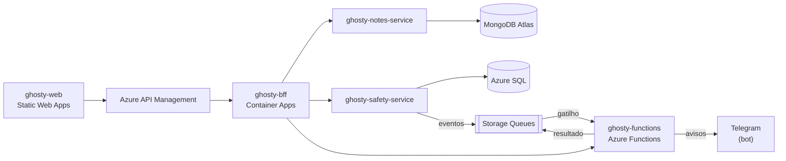

# ghosty-functions

Azure Functions do Ghosty: cálculo, enriquecimento de dados e processamento de eventos.

> **Status:** estrutura inicial. A implementação começa na Sprint 1.

## Sobre o Ghosty

O **Ghosty** é um app web de segurança pessoal discreto. Por fora, é um app de notas comum que funciona de verdade. Por dentro, tem uma área de segurança para avisar a rede de apoio da pessoa.

Os avisos à rede de apoio saem pelo **Telegram** (bot) ou por uma **página web** aberta pelo contato, sem telefone, SMS nem WhatsApp. O ensaio (Teste seguro) não envia nada. O Ghosty não aciona nem substitui os canais oficiais (190, 180 e 192).

Projeto acadêmico da disciplina de Soluções Cloud.

## Arquitetura da solução



## Este projeto

| Função | Gatilho | O que faz |
|---|---|---|
| `readiness` | HTTP | Calcula a prontidão da rede de apoio (pontuação e recomendações) |
| `message-preview` | HTTP | Enriquece a mensagem de alerta: link do mapa, horário local e contagem de caracteres (limite de 4.096 do Telegram) |
| `dispatch-alert` | Fila `help-requests` | Envia o aviso a cada contato confirmado, em ordem, pelo Telegram (ou registra para a página web do contato). No ensaio ou com `DELIVERY_MODE=simulated`, não envia nada |
| `telegram-webhook` | HTTP | Recebe o `/start` e o `/parar` do bot e vincula o contato à rede de apoio |
| `check-in-deadline` | Fila `check-in-deadlines` | Verifica no prazo se o check-in foi confirmado |

### Organização do código (Clean Architecture + Vertical Slice)

```text
src/
├── domain/          calculadoras e regras puras (prontidão, mensagem, limite de caracteres, plano de envio)
├── application/     casos de uso organizados por feature
├── infrastructure/  cliente HTTP do safety-service, publicação em filas e cliente do Telegram
└── functions/       registro dos gatilhos HTTP e de fila (camada de entrada)
```

## Tecnologias

- Node.js 24 + TypeScript
- Azure Functions (modelo de programação v4), plano Flex Consumption
- Azure Storage Queues (Azurite na máquina local)
- Vitest

## Como rodar localmente

> Em construção.

Pré-requisitos:

- Node.js 24 LTS (versão em `.nvmrc`)
- Azure Functions Core Tools v4 (`npm i -g azure-functions-core-tools@4 --unsafe-perm true`)
- Azurite (`npm i -g azurite`)

Comandos previstos:

```bash
npm ci
cp local.settings.example.json local.settings.json
azurite --silent --location ~/.azurite &   # emulador das filas
npm start                                  # porta 7071
```

## Testes

> Em construção. Comando previsto: `npm test`.

## Deploy

```bash
func azure functionapp publish <nome-da-function-app>
```

## Na nuvem (Azure)

> Os links serão adicionados depois do deploy.

## Projetos do repositório

| Pasta | Papel |
|---|---|
| [`ghosty-web`](../ghosty-web) | Microfrontend (shell + remotes `notes` e `safety`) |
| [`ghosty-bff`](../ghosty-bff) | Backend for Frontend: agregação e proxy |
| [`ghosty-notes-service`](../ghosty-notes-service) | Microserviço de notas (MongoDB Atlas) |
| [`ghosty-safety-service`](../ghosty-safety-service) | Microserviço de conta e rede de apoio (Azure SQL) |
| [`ghosty-functions`](../ghosty-functions) | Azure Functions: cálculo, enriquecimento e eventos |
| [`ghosty-docs`](../ghosty-docs) | Documentação: arc42, C4, AsyncAPI, contratos e infraestrutura |

## Alunos

- Amanda Fila de Lima
- Carlos Leonardo Garcia Pscheidt
- Rafael Della
- Gustavo Yuri
