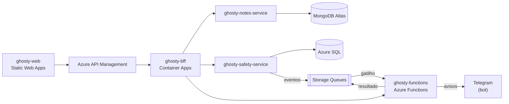

# ghosty-notes-service

Microserviço do domínio **Notas** do Ghosty, com MongoDB Atlas.

> **Status:** pronto: CRUD completo, resumo para o painel e o seed de demonstração, com testes de unidade, de arquitetura e de integração (MongoDB em memória).

## Sobre o Ghosty

O **Ghosty** é um app web de segurança pessoal discreto. Por fora, é um app de notas comum que funciona de verdade. Por dentro, tem uma área de segurança para avisar a rede de apoio da pessoa.

Os avisos à rede de apoio saem pelo **Telegram** (bot) ou por uma **página web** aberta pelo contato, sem telefone, SMS nem WhatsApp. O ensaio (Teste seguro) não envia nada. O Ghosty não aciona nem substitui os canais oficiais (190, 180 e 192).

Projeto acadêmico da disciplina de Soluções Cloud.

## Arquitetura da solução



## Este projeto

Responsável pelas notas do app: notas de texto e checklists, com cores, etiquetas, fixar, arquivar e lembretes. Oferece CRUD completo, documentado com Swagger. Só é chamado pelo BFF.

Casos de uso (vertical slices): `CreateNote`, `ListNotes`, `GetNote`, `UpdateNote`, `PatchNote`, `DeleteNote`, `DeleteAllNotesOfOwner` e `GetNotesSummary`.

### Organização do código (Clean Architecture + Vertical Slice)

```text
src/
├── domain/          entidade Note, itens de checklist e regras
├── application/     casos de uso (features/notes/<caso-de-uso>/) e portas (repositório, relógio, ids)
├── infrastructure/  repositório MongoDB (índices), variáveis com zod, relógio e UUID v7
└── api/             controllers, DTOs, guard da chave interna, Swagger e composição (useFactory)
    └── platform/    Problem Details, logs, /health e Swagger (cópia de config/nest, não editar)
```

As regras de dependência entre as camadas são verificadas por testes de arquitetura.

## Contrato e mock

O contrato v0 deste projeto está em [`ghosty-docs/contracts/notes-service.openapi.yaml`](../ghosty-docs/contracts/notes-service.openapi.yaml), com exemplos em cada operação. O mock sobe com `cd ../ghosty-docs && npm ci && npm run mock:notes` (porta 4011). Veja o [guia dos contratos e dos mocks](../ghosty-docs/contracts/README.md).

A configuração de TypeScript, ESLint, Prettier, Vitest e das regras de arquitetura vem de [`config/`](../config) (as cópias nesta pasta não devem ser editadas à mão).

## Tecnologias

- Node.js 24 + TypeScript
- NestJS 12 + `@nestjs/swagger`
- MongoDB Atlas (cluster Free em região Azure) com o driver oficial
- Vitest + ArchUnitTS + `mongodb-memory-server` (testes)
- Docker, Azure Container Apps

## Como rodar localmente

Pré-requisito: Node.js 24 LTS (versão em `.nvmrc`). Não precisa de Docker nem do Atlas.

```bash
npm ci
cp .env.example .env    # sem MONGODB_URI, usa um MongoDB em memória
npm run start:dev       # porta 3001 · Swagger em http://localhost:3001/docs
```

- `npm run start:memory` força o MongoDB em memória mesmo com `MONGODB_URI` preenchida. Os dados somem quando o serviço para.
- Com o Atlas, preencha `MONGODB_URI` (banco `notes_dev`). Os índices são criados na subida.
- `npm run build && npm start` roda a versão compilada (`dist/`).

| Variável | Padrão local | Para quê |
|---|---|---|
| `PORT` | `3001` | Porta HTTP |
| `MONGODB_URI` | vazia (MongoDB em memória) | URI do Atlas. Obrigatória em produção |
| `MONGODB_DB` | `notes_dev` | Nome do banco (`notes` na nuvem) |
| `INTERNAL_API_KEY` | `dev-internal-key` | Chave exigida no `X-Internal-Key` |
| `LOG_LEVEL` | `info` | Nível do log (JSON, com os campos sensíveis redigidos) |
| `DEMO_ACCOUNT_ID` | UUID de exemplo | Só para o seed: o mesmo UUID do safety-service |

**Seed de demonstração:** `npm run seed:demo` grava as 8 notas fictícias da conta demo (5 atualizadas nos últimos 14 dias, a lista do mercado fixada e o lembrete do dentista) e `npm run seed:reset` apaga só elas. Grava direto no MongoDB da `MONGODB_URI` (o Atlas, na preparação do vídeo).

Exemplo de chamada (o BFF envia os dois cabeçalhos):

```bash
curl -X POST http://localhost:3001/notes   -H "X-Internal-Key: dev-internal-key"   -H "X-User-Id: 01a15965-b480-79af-a113-29b2fc82e5ef"   -H "Content-Type: application/json"   -d "{\"kind\":\"checklist\",\"title\":\"Mercado\",\"items\":[{\"text\":\"pão\"}]}"
```

## Testes

```bash
npm test             # unidade, arquitetura e integração
npm run test:cov     # cobertura de domain + application (mínimo de 80%)
npm run lint         # ESLint + Prettier
npm run typecheck
npm run openapi:export   # grava o OpenAPI gerado pelo código em dist/openapi.json
```

- **Unidade:** regras da nota (título ou conteúdo, tipos, limites, conversão que preserva o texto, versão) e os 8 casos de uso, com um repositório em memória.
- **Arquitetura:** as regras de camadas, slices e nomes de `config/architecture`.
- **Integração:** HTTP + MongoDB em memória (`mongodb-memory-server`, que baixa o binário do MongoDB na primeira execução): proteções (`X-Internal-Key`, `X-User-Id`), Problem Details, 409 de versão, 404 de outra conta, índices e Swagger.

## Docker

O `Dockerfile` (multi-stage, usuário sem root) e o `.dockerignore` já estão nesta pasta. Sem Docker na máquina, as imagens são publicadas pelo GitHub Actions ([`docker.yml`](../.github/workflows/docker.yml)) ao criar uma tag `v*`. Com Docker:

```bash
docker build -t <usuario>/ghosty-notes-service:v1 .
docker push <usuario>/ghosty-notes-service:v1
```

## Na nuvem (Azure)

Roda no Azure Container Apps (`app-notes`), com o MongoDB Atlas num cluster em região Azure e a URI no Key Vault. A implantação está em [`ghosty-docs/infra`](../ghosty-docs/infra).

> Os links são preenchidos depois do deploy (`bash ghosty-docs/infra/deploy.sh status` imprime todos).

## Projetos do repositório

| Pasta | Papel |
|---|---|
| [`ghosty-web`](../ghosty-web) | Microfrontend (shell + remotes `notes` e `safety`) |
| [`ghosty-bff`](../ghosty-bff) | Backend for Frontend: agregação e proxy |
| [`ghosty-notes-service`](../ghosty-notes-service) | Microserviço de notas (MongoDB Atlas) |
| [`ghosty-safety-service`](../ghosty-safety-service) | Microserviço de conta e rede de apoio (Azure SQL) |
| [`ghosty-functions`](../ghosty-functions) | Azure Functions: cálculo, enriquecimento e eventos |
| [`ghosty-docs`](../ghosty-docs) | Documentação: arc42, C4, AsyncAPI, contratos e infraestrutura |

## Alunos

- Amanda Fila de Lima
- Carlos Leonardo Garcia Pscheidt
- Rafael Della
- Gustavo Yuri
