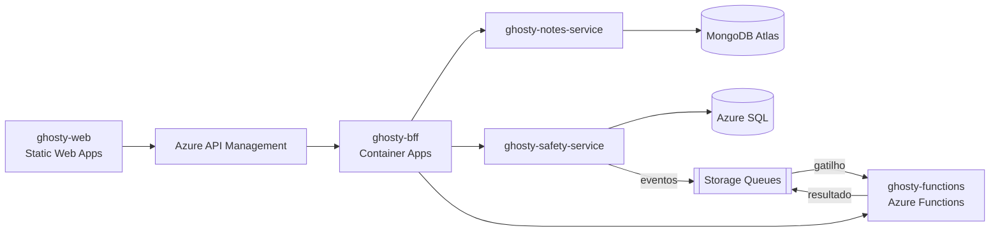

# ghosty-safety-service

Microserviço do domínio **Conta e Rede de apoio** do Ghosty, com Azure SQL Database.

> **Status:** estrutura inicial. A implementação começa na Sprint 1.

## Sobre o Ghosty

O **Ghosty** é um app web de segurança pessoal discreto. Por fora, é um app de notas comum que funciona de verdade. Por dentro, tem uma área de segurança para avisar a rede de apoio da pessoa.

Nesta fase, o envio de alertas é **simulado**: o sistema monta a mensagem e registra o que teria acontecido, sem enviar nada. O Ghosty não substitui os canais oficiais (190, 180 e 192).

Projeto acadêmico da disciplina de Soluções Cloud.

## Arquitetura da solução



## Este projeto

Responsável por:

- contas;
- contatos da rede de apoio e convites;
- mensagem de alerta;
- check-ins;
- pedidos de ajuda.

Oferece CRUD completo, documentado com Swagger. Publica eventos em filas do Azure Storage (transactional outbox) e consome o resultado das simulações feitas pela Azure Function. Só é chamado pelo BFF e pela Function.

Dados sensíveis ficam protegidos: senhas e códigos com hash Argon2id, e contatos, telefones e mensagens cifrados com AES-256-GCM.

### Organização do código (Clean Architecture + Vertical Slice)

```text
src/
├── domain/          entidades, value objects e máquinas de estado
├── application/     casos de uso organizados por feature (features/<feature>/<caso-de-uso>/)
├── infrastructure/  persistência (TypeORM), filas, criptografia e configuração
└── api/             controllers, DTOs, guards e Swagger (composição)
```

As regras de dependência entre as camadas são verificadas por testes de arquitetura.

## Tecnologias

- Node.js 24 + TypeScript
- NestJS 12 + `@nestjs/swagger`
- TypeORM: SQL Server na nuvem (Azure SQL) e SQLite na máquina local
- Azure Storage Queues (Azurite na máquina local)
- Argon2id e AES-256-GCM
- Vitest + ArchUnitTS
- Docker, Azure Container Apps

## Como rodar localmente

> Em construção.

Pré-requisitos: Node.js 24 LTS (versão em `.nvmrc`) e Azurite (`npm i -g azurite`).

Comandos previstos:

```bash
npm ci
cp .env.example .env    # DB_PROVIDER=sqlite para rodar sem SQL Server
npm run start:dev       # porta 3002 · Swagger em http://localhost:3002/docs
```

## Testes

> Em construção. Comandos previstos: `npm test` (unidade, arquitetura e integração).

## Docker

```bash
docker build -t <usuario>/ghosty-safety-service:v1 .
docker push <usuario>/ghosty-safety-service:v1
```

## Na nuvem (Azure)

> Os links serão adicionados depois do deploy.

## Projetos do repositório

| Pasta | Papel |
|---|---|
| [`ghosty-web`](../ghosty-web) | Microfrontend (shell + remotes `notes` e `safety`) |
| [`ghosty-bff`](../ghosty-bff) | Backend for Frontend: agregação e proxy |
| [`ghosty-notes-service`](../ghosty-notes-service) | Microserviço de notas (MongoDB Atlas) |
| [`ghosty-safety-service`](../ghosty-safety-service) | Microserviço de conta e rede de apoio (Azure SQL) |
| [`ghosty-functions`](../ghosty-functions) | Azure Functions: cálculo, enriquecimento e eventos |
| [`ghosty-docs`](../ghosty-docs) | Documentação: arc42, C4, AsyncAPI, contratos e infraestrutura |

## Alunos

- Amanda Fila de Lima
- Carlos Leonardo Garcia Pscheidt
- Rafael Della
- Gustavo Yuri
