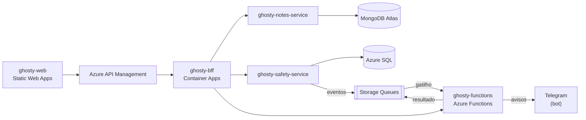

# ghosty-safety-service

Microserviço do domínio **Conta e Rede de apoio** do Ghosty, com Azure SQL Database.

> **Status:** pronto e testado: as 39 operações do contrato (contas, código secreto, refresh tokens, rede de apoio, convites, vínculo com o Telegram, mensagem, resumo, check-ins e pedidos de ajuda, e as rotas internas da Function), mensageria (outbox e consumidor), migrações do SQL Server e o seed de demonstração.

## Sobre o Ghosty

O **Ghosty** é um app web de segurança pessoal discreto. Por fora, é um app de notas comum que funciona de verdade. Por dentro, tem uma área de segurança para avisar a rede de apoio da pessoa.

Os avisos à rede de apoio saem pelo **Telegram** (bot) ou por uma **página web** aberta pelo contato, sem telefone, SMS nem WhatsApp. O ensaio (Teste seguro) não envia nada. O Ghosty não aciona nem substitui os canais oficiais (190, 180 e 192).

Projeto acadêmico da disciplina de Soluções Cloud.

## Arquitetura da solução



## Este projeto

Responsável por:

- contas;
- contatos da rede de apoio e convites;
- mensagem de alerta;
- check-ins;
- pedidos de ajuda.

Oferece CRUD completo, documentado com Swagger. Publica eventos em filas do Azure Storage (transactional outbox) e consome o resultado dos envios feitos pela Azure Function. Só é chamado pelo BFF e pela Function.

Dados sensíveis ficam protegidos: senhas e códigos com hash Argon2id, e contatos (apelido e chat do Telegram) e mensagens cifrados com AES-256-GCM. O sistema não guarda telefone.

### Organização do código (Clean Architecture + Vertical Slice)

```text
src/
├── domain/          entidades, value objects e máquinas de estado
├── application/     casos de uso organizados por feature (features/<feature>/<caso-de-uso>/)
├── infrastructure/  persistência (TypeORM com EntitySchema, SQLite ou SQL Server), filas, criptografia e configuração
└── api/             controllers, DTOs, guard da chave interna, Swagger e composição (useFactory)
    └── platform/    Problem Details, logs, /health e Swagger (cópia de config/nest, não editar)
```

As regras de dependência entre as camadas são verificadas por testes de arquitetura.

## Contrato e mock

O contrato v0 deste projeto está em [`ghosty-docs/contracts/safety-service.openapi.yaml`](../ghosty-docs/contracts/safety-service.openapi.yaml), com exemplos em cada operação. O mock sobe com `cd ../ghosty-docs && npm ci && npm run mock:safety` (porta 4012). Veja o [guia dos contratos e dos mocks](../ghosty-docs/contracts/README.md).

Os eventos que este serviço publica e consome estão em [`ghosty-docs/asyncapi/`](../ghosty-docs/asyncapi), com os JSON Schemas para validar com `ajv`.

A configuração de TypeScript, ESLint, Prettier, Vitest e das regras de arquitetura vem de [`config/`](../config) (as cópias nesta pasta não devem ser editadas à mão).

## Tecnologias

- Node.js 24 + TypeScript
- NestJS 12 + `@nestjs/swagger`
- TypeORM: SQL Server na nuvem (Azure SQL) e SQLite na máquina local
- Azure Storage Queues (Azurite na máquina local)
- Argon2id e AES-256-GCM
- Vitest + ArchUnitTS
- Docker, Azure Container Apps

## Como rodar localmente

Pré-requisito: Node.js 24 LTS (versão em `.nvmrc`). Não precisa de Docker nem da Azure: na máquina local o banco é um SQLite em arquivo e as filas ficam no Azurite.

```bash
npm ci
cp .env.example .env    # já funciona na máquina local (chave de cifra só de desenvolvimento)
npx azurite-queue --inMemoryPersistence --skipApiVersionCheck   # outro terminal (ou: azurite, se instalado)
npm run start:dev       # porta 3002 · Swagger em http://localhost:3002/docs
```

- O esquema do SQLite (`./data/safety.sqlite`) é criado na subida. No Azure SQL (`DB_PROVIDER=mssql`), a aplicação não roda DDL: as migrações de `src/infrastructure/persistence/migrations/mssql` saem do `npm run migration:run`, com o usuário admin (o da aplicação só lê e grava).
- Sem o Azurite, use `MESSAGING_ENABLED=false`: os eventos ficam guardados no outbox e saem quando as filas voltarem.
- Chaves de verdade (nuvem): `openssl rand -base64 32` para `DATA_ENCRYPTION_KEY` e `openssl rand -hex 32` para `INTERNAL_API_KEY`. A chave de desenvolvimento do `.env.example` é recusada com `NODE_ENV=production`.

| Variável | Padrão local | Para quê |
|---|---|---|
| `PORT` | `3002` | Porta HTTP |
| `DB_PROVIDER` · `SQLITE_PATH` | `sqlite` · `./data/safety.sqlite` | Banco local |
| `MSSQL_HOST` · `MSSQL_PORT` · `MSSQL_DATABASE` · `MSSQL_USER` · `MSSQL_PASSWORD` | vazias | Azure SQL (`DB_PROVIDER=mssql`) |
| `DB_POOL_MIN` · `DB_POOL_IDLE_MS` | `0` · `30000` | Pool que deixa o banco serverless pausar |
| `INTERNAL_API_KEY` | `dev-internal-key` | Chave exigida no `X-Internal-Key` |
| `DATA_ENCRYPTION_KEY` | chave de desenvolvimento | AES-256-GCM dos campos sensíveis (32 bytes em Base64) |
| `MESSAGING_ENABLED` | `true` | Liga o despachante do outbox e o consumidor da fila |
| `QUEUE_CONNECTION_STRING` | `UseDevelopmentStorage=true` | Azurite (ou a Storage da Azure) |
| `QUEUE_HELP_REQUESTS` · `QUEUE_CHECKIN_DEADLINES` · `QUEUE_ALERT_DISPATCHES` | `help-requests` · `check-in-deadlines` · `alert-dispatches` | Nomes das filas |
| `CODE_MAX_ATTEMPTS` · `CODE_LOCK_MINUTES` | `5` · `15` | Bloqueio do código secreto |
| `INVITE_BASE_URL` · `INVITE_TTL_HOURS` | `http://localhost:5173/c` · `72` | Link e validade do convite |
| `TELEGRAM_BOT_USERNAME` | `ghosty_dev_bot` | Só para montar o link `t.me/<bot>?start=<token>` |
| `APP_TIMEZONE` | `America/Sao_Paulo` | Fuso da hora na mensagem do aviso (vai no evento) |
| `DB_RUN_MIGRATIONS` | `false` | Só com `mssql`: rodar as migrações na subida (exige permissão de DDL) |
| `DEMO_ACCOUNT_ID` · `DEMO_PASSWORD` · `DEMO_LOCK_CODE` · `DEMO_TELEGRAM_CHAT_ID` | UUID de exemplo · vazias | Só para o seed de demonstração |
| `LOG_LEVEL` | `info` | Nível do log (JSON, com os campos sensíveis redigidos) |

## Testes

```bash
npm test             # unidade, arquitetura e integração (SQLite em memória e Azurite)
npm run test:cov     # cobertura de domain + application (mínimo de 80%)
npm run lint
npm run typecheck
npm run openapi:export   # grava o OpenAPI gerado pelo código em dist/openapi.json
npm run migration:run    # aplica as migrações no Azure SQL (DB_PROVIDER=mssql, com o usuário admin)
npm run seed:demo        # conta "Maria Exemplo", rede (Ana, Beto, Carla), mensagem e um Teste seguro (seed:reset apaga)
```

- **Domínio:** toda transição proibida das máquinas de estado (contato, check-in, pedido de ajuda) gera erro de domínio; bloqueio do código depois de 5 erros.
- **Casos de uso:** rodam contra o SQLite em memória (o mesmo adaptador da máquina local), com a cifra real e um hasher rápido.
- **Integração:** HTTP (Supertest) com Problem Details, a mesma resposta para código errado e conta bloqueada, convites (72 horas, uma resposta só), vínculo e saída do Telegram e exclusão em cascata. A mensageria sobe o Azurite em memória (devDependency, sem Docker): o outbox publica em Base64, falha deixa o evento pendente, o consumidor grava a linha do tempo uma vez só e mensagens fora do formato vão para a fila `-poison`.
- **Check-ins e pedidos de ajuda:** tolerância padrão da mensagem, um ativo por modo, `Idempotency-Key` (24 horas), estender sobe a versão e o prazo antigo é ignorado, vencer cria um pedido de origem `check_in` uma vez só, a localização só é guardada com "incluir localização", os destinos (com o chat decifrado) só pela rota interna, a linha do tempo com o apelido de cada contato e "foi engano".
- **Eventos:** cada mensagem passa no JSON Schema do AsyncAPI antes de entrar no outbox (fora do schema, a transação é desfeita), e o fluxo pedido → fila e check-in → fila com atraso é conferido no Azurite.
- **Migração:** confere que a migração do SQL Server tem toda tabela, coluna, índice e restrição dos `EntitySchema`.

## Docker

O `Dockerfile` (multi-stage, usuário sem root) e o `.dockerignore` já estão nesta pasta. Sem Docker na máquina, as imagens são publicadas pelo GitHub Actions ([`docker.yml`](../.github/workflows/docker.yml)) ao criar uma tag `v*`. Com Docker:

```bash
docker build -t <usuario>/ghosty-safety-service:v1 .
docker push <usuario>/ghosty-safety-service:v1
```

## Na nuvem (Azure)

Roda no Azure Container Apps (`app-core`), com o Azure SQL (free tier, pausa automática), as filas do Azure Storage e os segredos no Key Vault. A implantação está em [`ghosty-docs/infra`](../ghosty-docs/infra).

| Item | Link |
|---|---|
| Swagger (direto no Container App) | https://app-core.graybeach-32f9183a.brazilsouth.azurecontainerapps.io/docs |
| Swagger pelo API Gateway | https://proud-field-09986c10f.3.azurestaticapps.net/swagger.html?spec=apim-safety-service |
| Imagem no Docker Hub | https://hub.docker.com/r/oldspiffy/ghosty-safety-service (tag `v1`) |

Todos os links da entrega ficam reunidos na [página de documentação](https://proud-field-09986c10f.3.azurestaticapps.net).

## Projetos do repositório

| Pasta | Papel |
|---|---|
| [`ghosty-web`](../ghosty-web) | Microfrontend (shell + remotes `notes` e `safety`) |
| [`ghosty-bff`](../ghosty-bff) | Backend for Frontend: agregação e proxy |
| [`ghosty-notes-service`](../ghosty-notes-service) | Microserviço de notas (MongoDB Atlas) |
| [`ghosty-safety-service`](../ghosty-safety-service) | Microserviço de conta e rede de apoio (Azure SQL) |
| [`ghosty-functions`](../ghosty-functions) | Azure Functions: cálculo, enriquecimento e eventos |
| [`ghosty-docs`](../ghosty-docs) | Documentação: arc42, C4, AsyncAPI, contratos e infraestrutura |

## Alunos

- Amanda Fila de Lima
- Carlos Leonardo Garcia Pscheidt
- Rafael Della
- Gustavo Yuri
