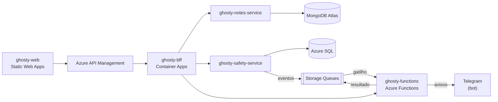

# ghosty-web

Microfrontend do Ghosty: um shell e dois remotes, unidos por Module Federation.

> **Status:** pronto e testado: shell (Entrar, Criar conta, Configurações, desbloqueio pela busca, saída rápida, trancamento com a aba oculta, rota pública do convite e PWA "Notas"), remote `notes` (a fachada completa) e remote `safety` (painel, pedido de ajuda, rede de apoio, mensagem, check-in, Teste seguro, canais oficiais, ajustes e a página do convite).

## Sobre o Ghosty

O **Ghosty** é um app web de segurança pessoal discreto. Por fora, é um app de notas comum que funciona de verdade. Por dentro, tem uma área de segurança para avisar a rede de apoio da pessoa.

Os avisos à rede de apoio saem pelo **Telegram** (bot) ou por uma **página web** aberta pelo contato, sem telefone, SMS nem WhatsApp. O ensaio (Teste seguro) não envia nada. O Ghosty não aciona nem substitui os canais oficiais (190, 180 e 192).

Projeto acadêmico da disciplina de Soluções Cloud.

## Arquitetura da solução



## Este projeto

O front só conversa com o BFF, sempre pelo API Gateway. Ele é dividido em apps independentes:

| Pasta | Papel |
|---|---|
| `apps/shell` | Host: login, sessão, carregamento dos remotes e saída rápida |
| `apps/notes` | Remote da fachada: notas e listas |
| `apps/safety` | Remote da área de segurança, carregado sob demanda |
| `packages/ui` | Tokens de design e componentes base |
| `packages/api-client` | Cliente tipado do BFF, gerado a partir do OpenAPI |

## Contrato e mock

O contrato que o front consome está em [`ghosty-docs/contracts/bff.openapi.yaml`](../ghosty-docs/contracts/bff.openapi.yaml), com exemplos em cada operação. O mock sobe com `cd ../ghosty-docs && npm ci && npm run mock:bff` (porta 4010). Veja o [guia dos contratos e dos mocks](../ghosty-docs/contracts/README.md).

Enquanto o BFF não existe, use `VITE_API_BASE_URL=http://localhost:4010` com o mock: `cd ../ghosty-docs && npm run mock:bff`.

A configuração de TypeScript, ESLint, Prettier, Vitest e das regras de arquitetura vem de [`config/`](../config) (as cópias nesta pasta não devem ser editadas à mão).

## Tecnologias

- React 19 + TypeScript
- Vite + `@module-federation/vite`
- React Router 7, TanStack Query 5, react-hook-form + zod
- CSS Modules
- Vitest + Testing Library + MSW
- Hospedagem: Azure Static Web Apps

## Como rodar localmente

Pré-requisito: Node.js 24 LTS. O front chama só o BFF (na máquina local, direto, sem o API Management).

```bash
npm ci
npm run dev          # shell (5173) + notes (5174) + safety (5175), em paralelo
```

- Abra http://localhost:5173. Sem o BFF rodando, aponte para o mock: `cd ../ghosty-docs && npm run mock:bff` (porta 4010) e use `VITE_API_BASE_URL=http://localhost:4010` em `apps/shell/.env.local`.
- Cada remote também roda sozinho contra o mock (`npm run dev:notes` e `npm run dev:safety`), com tokens de desenvolvimento.
- `npm run build` gera os 3 apps (`apps/*/dist`); `npm run preview` serve o build.
- `npm run generate` regera `packages/api-client/src/schema.d.ts` a partir de `ghosty-docs/contracts/bff.openapi.yaml`.
- `npm run swa:config` grava, depois do build, o `staticwebapp.config.json` de cada app com as origens da nuvem: CSP no shell e CORS só para o shell nos remotes (variáveis `SHELL_ORIGIN`, `NOTES_ORIGIN`, `SAFETY_ORIGIN` e `API_ORIGIN`).

| Variável (build do Vite) | Local | Para quê |
|---|---|---|
| `VITE_API_BASE_URL` | `http://localhost:3000` | BFF (na nuvem, a URL do APIM, com o sufixo da API se houver) |
| `VITE_APIM_SUBSCRIPTION_KEY` | vazia | Chave pública do produto `web-app` do APIM |
| `VITE_NOTES_REMOTE_URL` | `http://localhost:5174/remoteEntry.js` | Remote `notes` (o `safety` vem do BFF no desbloqueio) |

### Como as peças se encaixam

```text
apps/shell     host do Module Federation, BrowserRouter, AuthProvider (dono da sessão) e as telas da conta
apps/notes     remote "notes/App": lista, busca local, editor (texto e checklist), cores, etiquetas, lembrete
apps/safety    remote "safety/App": MemoryRouter, onboarding, painel, pedido de ajuda, rede, mensagem, check-in,
               Teste seguro, canais oficiais e ajustes; e "safety/Invite": a página pública do convite
packages/ui            tokens (variáveis CSS) e componentes base, com alvos de toque de 44 px
packages/api-client    cliente tipado do BFF (openapi-fetch) e o contrato shell ↔ remotes
```

- O JWT e o token da sessão segura ficam só em memória; o refresh token fica no `localStorage` (o "continuar conectado" das notas). Os remotes nunca veem os tokens: recebem um `ApiClient` pronto, que renova o JWT uma vez no 401 e aciona a saída rápida no 403 da área de segurança.
- A busca filtra no navegador. No Enter, o shell testa `/^\d{6,8}$/`: se bater, chama `POST /safety/session`; com o código certo, registra o remote `safety` com a URL que o BFF devolve. A URL continua `/` e o título continua "Notas".
- Saída rápida: botão "Voltar às notas" ou Esc duas vezes. Revoga a sessão no BFF, apaga o cache `[safety, ...]` e volta às notas.
- O remote `safety` sai sem source maps e com arquivos nomeados só pelo hash.
- **Pedido de ajuda:** o botão só responde segurado por 2 segundos (também com Espaço ou Enter), depois vem a contagem com o "Cancelar" já focado, a localização (se a pessoa ativou na mensagem) e o `POST /safety/help-requests` com uma `Idempotency-Key` nova. A linha do tempo é consultada a cada 2 segundos até o envio terminar ("ainda processando" depois de 60 s).
- **Teste seguro:** o mesmo caminho com `mode: test` (selo "Ensaio" e "Nada foi enviado"), e um check-in de ensaio que vence em pouco mais de 1 minuto.
- **Check-in:** destino, horário (o próximo HH:MM) e tolerância; o card do check-in ativo tem "Cheguei bem", "Mais 15/30 min" e "Cancelar".
- **Convite (`/c/:token`):** o shell confere o token no BFF e só então carrega o `safety/Invite`. Token desconhecido mostra uma tela neutra. O contato aceita pelo Telegram (link `t.me`), pelo navegador (a página vira o painel de avisos, consultado a cada 5 segundos) ou recusa.
- **Aba oculta:** com a área de segurança aberta, a aba oculta por mais de 2 minutos tranca sozinha.
- **PWA:** manifest "Notas", ícones neutros e um service worker que guarda só o shell e o remote `notes` (nunca a API nem a outra área). Só é registrado no build de produção.

## Testes

```bash
npm test             # Vitest + Testing Library + MSW (jsdom), sem servidor de verdade
npm run lint         # ESLint (com as regras do React) + Prettier
npm run typecheck
npm run build
```

Cobrem: entrar, criar conta, continuar conectado, código de bloqueio com a senha atual, excluir conta, desbloqueio (texto comum nunca chama o BFF; código errado não muda a tela), saída rápida e o trancamento com a aba oculta; a rota do convite (token válido carrega o remote com a URL do BFF, desconhecido ou vencido não baixa nada); a fachada (fixadas primeiro, busca local sem chamada ao servidor, Enter avisando o shell, editor com conflito de versão e item marcado); o service worker (o que entra e o que nunca entra no cache) e o manifest neutro; e, no remote `safety`, a prontidão com o aviso de cálculo simplificado, a reordenação da rede, o convite, o debounce de 500 ms da prévia, o botão de segurar (só dispara em 2 s, pelo ponteiro e pelo teclado), a contagem que cancela sem chamar a API, a linha do tempo de `triggered` a `dispatched` e o "foi engano", o Teste seguro (nada enviado), o ensaio do check-in, as validações e ações do check-in e as 3 opções da página do convite.

Os testes de arquitetura ([`test/architecture.test.ts`](test/architecture.test.ts), com o archunit, como nos backends) garantem as fronteiras do microfrontend: o shell não importa o código dos remotes (eles só chegam pelo Module Federation, e o `safety` só depois do desbloqueio), os remotes não se conhecem, os pacotes compartilhados não dependem dos apps, o `packages/ui` não usa o `api-client`, nenhum app chama a rede direto (tudo passa pelo `api-client`, que só fala com o BFF) e não há dependências circulares.

## Na nuvem (Azure)

Os 3 apps são publicados em Static Web Apps separados (plano Free), com hostnames aleatórios: o shell, o remote `notes` e o remote `safety`. O build da nuvem aponta para o API Management. A implantação está em [`ghosty-docs/infra`](../ghosty-docs/infra).

> Os links são preenchidos depois do deploy (`bash ghosty-docs/infra/deploy.sh status` imprime todos).

## Projetos do repositório

| Pasta | Papel |
|---|---|
| [`ghosty-web`](../ghosty-web) | Microfrontend (shell + remotes `notes` e `safety`) |
| [`ghosty-bff`](../ghosty-bff) | Backend for Frontend: agregação e proxy |
| [`ghosty-notes-service`](../ghosty-notes-service) | Microserviço de notas (MongoDB Atlas) |
| [`ghosty-safety-service`](../ghosty-safety-service) | Microserviço de conta e rede de apoio (Azure SQL) |
| [`ghosty-functions`](../ghosty-functions) | Azure Functions: cálculo, enriquecimento e eventos |
| [`ghosty-docs`](../ghosty-docs) | Documentação: arc42, C4, AsyncAPI, contratos e infraestrutura |

## Alunos

- Amanda Fila de Lima
- Carlos Leonardo Garcia Pscheidt
- Rafael Della
- Gustavo Yuri
