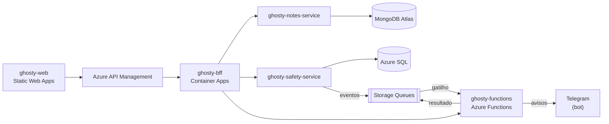

# ghosty-web

Microfrontend do Ghosty: um shell e dois remotes, unidos por Module Federation.

> **Status:** estrutura inicial. A implementação começa na Sprint 1.

## Sobre o Ghosty

O **Ghosty** é um app web de segurança pessoal discreto. Por fora, é um app de notas comum que funciona de verdade. Por dentro, tem uma área de segurança para avisar a rede de apoio da pessoa.

Os avisos à rede de apoio saem pelo **Telegram** (bot) ou por uma **página web** aberta pelo contato, sem telefone, SMS nem WhatsApp. O ensaio (Teste seguro) não envia nada. O Ghosty não aciona nem substitui os canais oficiais (190, 180 e 192).

Projeto acadêmico da disciplina de Soluções Cloud.

## Arquitetura da solução



## Este projeto

O front só conversa com o BFF, sempre pelo API Gateway. Ele é dividido em apps independentes:

| Pasta | Papel |
|---|---|
| `apps/shell` | Host: login, sessão, carregamento dos remotes e saída rápida |
| `apps/notes` | Remote da fachada: notas e listas |
| `apps/safety` | Remote da área de segurança, carregado sob demanda |
| `packages/ui` | Tokens de design e componentes base |
| `packages/api-client` | Cliente tipado do BFF, gerado a partir do OpenAPI |

## Tecnologias

- React 19 + TypeScript
- Vite + `@module-federation/vite`
- React Router 7, TanStack Query 5, react-hook-form + zod
- CSS Modules
- Vitest + Testing Library + MSW
- Hospedagem: Azure Static Web Apps

## Como rodar localmente

> Em construção.

Pré-requisito: Node.js 24 LTS (versão em `.nvmrc`).

Comandos previstos:

```bash
npm ci
npm run dev   # shell em :5173, notes em :5174, safety em :5175
```

## Testes

> Em construção. Comando previsto: `npm test`.

## Na nuvem (Azure)

> Os links serão adicionados depois do deploy.

## Projetos do repositório

| Pasta | Papel |
|---|---|
| [`ghosty-web`](../ghosty-web) | Microfrontend (shell + remotes `notes` e `safety`) |
| [`ghosty-bff`](../ghosty-bff) | Backend for Frontend: agregação e proxy |
| [`ghosty-notes-service`](../ghosty-notes-service) | Microserviço de notas (MongoDB Atlas) |
| [`ghosty-safety-service`](../ghosty-safety-service) | Microserviço de conta e rede de apoio (Azure SQL) |
| [`ghosty-functions`](../ghosty-functions) | Azure Functions: cálculo, enriquecimento e eventos |
| [`ghosty-docs`](../ghosty-docs) | Documentação: arc42, C4, AsyncAPI, contratos e infraestrutura |

## Alunos

- Amanda Fila de Lima
- Carlos Leonardo Garcia Pscheidt
- Rafael Della
- Gustavo Yuri
